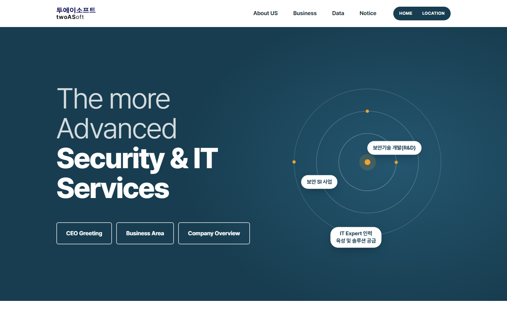
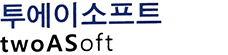
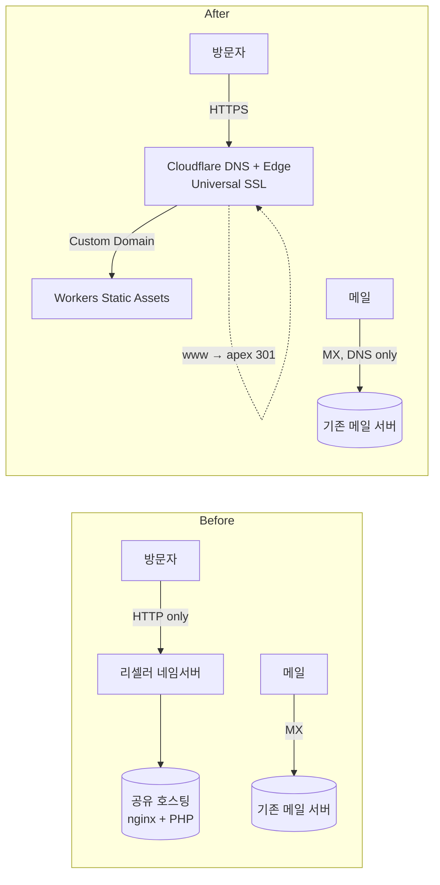

# twoasoft.co.kr — 기업 홈페이지 리뉴얼 & HTTPS 전환

> HTTP로만 운영되던 중소 IT 보안기업 홈페이지를
> **정적 사이트로 다시 만들고, 메일을 보존하면서 HTTPS 도메인으로 이전**한 프로젝트입니다.

**운영 주소:** https://twoasoft.co.kr

| Before | After |
|---|---|
| PHP 게시판 CMS(그누보드4, EUC-KR) on 공유 호스팅 | 빌드 없는 정적 사이트(HTML·CSS·JS) on Cloudflare Workers |
| **HTTP 전용**: 443 포트는 열려 있지만 TLS 핸드셰이크 실패 | **HTTPS 전용**: Universal SSL, HTTP→HTTPS 301, HSTS |
| 저해상도 JPG/PNG 로고·아이콘 | 인라인 SVG 로고 + SVG 아이콘 |
| 보안 헤더 없음 | CSP(해시 기반), HSTS, nosniff, frame-ancestors 등 |
| DNS: 리셀러 호스팅 네임서버 | DNS: Cloudflare(메일 레코드 그대로 보존) |



---

## 무엇을 했나

### 1. 리디자인 (정적 원페이지)
- 기존 사이트의 콘텐츠(인사말·사업영역·회사개요·오시는길·자료실)를 **한 페이지 구조**로 재구성했습니다.
- 빌드 도구 없이 `index.html` + `css/style.css` + `js/main.js`만으로 구성해 유지보수 부담을 최소화했습니다.
- 반응형(데스크톱/모바일), 키보드 접근성(스킵 링크, 탭 UI의 방향키 이동, `aria-*`), 스크롤 위치에 따른 메뉴 하이라이트를 구현했습니다.
- 228×55px JPG 로고를 **인라인 SVG `<text>`** 로, 134px PNG 아이콘 3개를 **SVG**로 다시 그렸습니다. 고해상도 화면에서도 흐려지지 않습니다.

| 원본 로고 (JPG) | 원본 아이콘 (PNG) |
|---|---|
|  |    |

새 SVG 결과물은 [`twoasoft/assets/img/`](twoasoft/assets/img/)와 `index.html` 헤더에 있습니다.

### 2. 보안 헤더 설계 — [`twoasoft/_headers`](twoasoft/_headers)
- `default-src 'none'`에서 시작해 **실제로 쓰는 자원만** 허용하는 CSP를 작성했습니다(폰트 CDN, Google Maps iframe).
- `<head>`의 FOUC 방지용 인라인 스크립트 한 줄은 `'unsafe-inline'` 대신 **sha256 해시**로 허용했습니다.
- `style-src-attr 'none'`, `script-src-attr 'none'`: HTML에 인라인 스타일과 이벤트 핸들러를 두지 않는다는 원칙을 정책으로 강제했습니다. 그래서 SVG도 `style` 대신 표현 속성(`fill`, `stroke`)만 사용했습니다.
- HSTS는 롤백 가능성을 고려해 **180일, `includeSubDomains`와 `preload` 없이** 설정했습니다(이유는 [이전 문서](docs/https-domain-migration.md#6-위험과-롤백) 참고).
- 파일명에 해시가 없으므로 캐시를 차등 적용했습니다: 이미지 30일, CSS·JS 5분, HTML은 매번 재검증.
- 미리보기용 `*.workers.dev` 주소에는 `X-Robots-Tag: noindex`를 붙여 검색엔진 중복 색인을 막았습니다.

### 3. HTTPS·도메인 이전 — [상세 문서](docs/https-domain-migration.md)
가장 공들인 부분입니다. 핵심 제약은 **"회사 메일이 끊기면 안 된다"** 와 **"도메인 관리 계정이 우리에게 없다"** 였습니다.



1. **현황 조사:** 레지스트리(`.kr`) 위임, 4개 권한 네임서버의 응답을 직접 조회해 DNS 원장을 만들었습니다. 이 과정에서 `* CNAME @` **와일드카드**가 `mail`·`_dmarc`·`_domainkey` 같은 이름까지 합성해 응답하고 있다는 사실을 확인했습니다.
2. **Cloudflare 존 준비(전환 전):** 모든 레코드를 *DNS only*(프록시 끔)로 옮긴 뒤, Cloudflare 권한 서버에서 조회한 이름들의 A/MX/TXT 최종 값이 옛 서버와 같은지 먼저 확인했습니다. 네임서버 변경과 웹 전환을 분리해 위험을 줄였습니다(전체 존의 완전 동일성은 존 파일이 없어 확정하지 못했습니다).
3. **네임서버 변경:** 도메인 관리 계정은 기존 웹 에이전시(리셀러)가 갖고 있었습니다. DNS 관리 권한 없이 할 수 있는 길(리디렉트 업로드, 서버 인증서 설치, Cloudflare CNAME setup·for SaaS 등)은 모두 호스팅 측 SSL 설치나 기존 DNS 수정 같은 **업체 협조가 필요한 조건부 대안**이었습니다. 이 중 한 번의 요청으로 이후 관리권까지 가져올 수 있는 **네임서버 변경을 채택**하고, 변경 요청 문안을 만들어 업체에 의뢰했습니다.
4. **컷오버:** 위임 반영과 존 Active, Universal SSL 발급을 확인했습니다. 그다음 웹 레코드 2개(apex A, www CNAME)만 지우고 바로 Worker Custom Domain을 연결했습니다. 레코드 삭제부터 배포 완료까지 약 1분이었습니다(실제 서비스 중단 시간은 따로 측정하지 않았습니다).
5. **HTTPS 정책:** SSL Full (strict), Always Use HTTPS, `www → apex` 301 Single Redirect(경로·쿼리 보존)를 설정했습니다.
6. **검증:** 아래 항목을 모두 확인했습니다. 결과는 [검증 문서](docs/verification.md)에 있습니다.
   - HTTP/HTTPS × apex/www 응답 매트릭스
   - 404 동작
   - 인증서 체인과 SAN
   - DS 레코드 유무
   - 메일 레코드(MX·SPF·와일드카드) 보존 여부

### 4. 운영 중 콘텐츠 업데이트
- 대표 인사말과 사업영역 문구 교체
- 오시는길에 **본사/지사 지도 전환 버튼** 추가: `aria-pressed` 토글 버튼이며, JS가 꺼져 있으면 숨김
- 각 변경은 로컬 미리보기(데스크톱 1280px, 모바일 375px)로 확인한 뒤 배포하고, 운영 주소에서 다시 확인했습니다.

---

## 기술적으로 고민한 지점

| 문제 | 판단 |
|---|---|
| 와일드카드 CNAME을 어떻게 옮길까? | 개별 A 레코드를 나열하면 원장에 없는 이름이 깨질 수 있습니다. 그래서 `* A`에 더해 **`* MX`, `* TXT`** 까지 만들어, 와일드카드 CNAME이 돌려주던 응답을 하위 이름에서도 그대로 재현했습니다. |
| 네임서버 변경 전후 위험 | 변경 전에 Cloudflare 존을 옛 존과 같은 값으로 채우고, 조회한 이름들의 응답이 같은지 확인해 **NS 변경의 영향을 최소화**했습니다. 웹 전환은 그 뒤에 별도 단계로 진행했습니다. |
| HSTS와 롤백 | 옛 서버는 HTTPS가 안 됩니다. HSTS를 길게 걸면 DNS를 되돌려도 브라우저가 접속하지 못합니다. 그래서 180일로 두고 서브도메인과 preload는 제외했으며, 롤백 시에는 **Worker 이전 버전 복구를 우선**하도록 계획했습니다. |
| Pages vs Workers | 처음에는 Cloudflare Pages로 준비했다가, Cloudflare 공식 이전 가이드(Pages → Workers Static Assets)를 따라 `wrangler.jsonc` 기반 Workers로 전환했습니다. 정적 자산만 올리는 스크립트 없는 Worker 구성입니다. |
| 캐시 때문에 "배포했는데 안 바뀜" | 엣지와 브라우저 캐시로 1~5분간 옛 파일이 보이는 현상을 실제로 겪었습니다. 그래서 HTML은 `max-age=0, must-revalidate`, JS·CSS는 5분으로 두고, 배포 후에는 운영 주소의 ETag와 본문을 확인하는 절차를 만들었습니다. |
| 로컬 도구가 옛 IP로 접속 | 전환 직후 이 PC의 `curl`만 옛 서버 IP로 접속했습니다. 공용 DNS(8.8.8.8, 1.1.1.1), Cloudflare 권한 서버, .NET, 브라우저는 모두 정상이었으므로, 방문자 영향이 없는 로컬 문제로 분리해 기록했습니다. |

---

## AI 협업 방식

이 프로젝트는 **두 AI 모델에 역할을 나눠** 진행했습니다. 자세한 내용은 [`docs/ai-collaboration.md`](docs/ai-collaboration.md)에 있습니다.
- **GPT(지휘):** 목표·범위·완료 기준을 담은 *TASK PACKET*을 작성하고, 결과를 근거와 대조해 승인하거나 반려했습니다.
- **Claude(실행):** DNS 조회, 대시보드 설정, 배포, 검증을 수행하고 *CLAUDE RESULT*로 증거와 편차를 보고했습니다.
- 예: 도메인 전환 결과에 대해 GPT가 "**조건부 승인**: 원장 증거 보강, 30분 후 재확인, www TLS 재검사 원문 필요"를 요구했고, 보강 자료를 제출했습니다. 인사말 사진 교체 건은 "게재 권한 미확인"으로 한 차례 **반려**됐다가, 권한을 확인한 뒤 진행했습니다.
- 비밀번호 입력, 로그인, 도메인 업체 연락은 사람이 맡았습니다.

---

## 폴더 구조

```
.
├── twoasoft/              # 배포되는 정적 사이트 루트
│   ├── index.html
│   ├── 404.html
│   ├── css/style.css
│   ├── js/main.js
│   ├── assets/img/        # SVG 아이콘, 대표 사진
│   ├── _headers           # 보안 헤더 · 캐시 정책
│   └── robots.txt
├── wrangler.jsonc         # Cloudflare Workers 설정 (Custom Domain 2개)
└── docs/
    ├── https-domain-migration.md   # 이전 런북 · DNS 원장 · 롤백 계획
    ├── verification.md             # 실제 검증 결과
    ├── ai-collaboration.md         # 역할 분담 · 검토 기록
    └── images/
```

## 배포

```bash
npx wrangler@latest deploy --dry-run   # 설정·자산 확인
npx wrangler@latest deploy             # twoasoft.co.kr, www.twoasoft.co.kr, *.workers.dev
```

롤백은 `npx wrangler@latest rollback <version-id>`로 합니다.

## 기술 스택
HTML · CSS(Grid, `clamp()`, `prefers-reduced-motion`) · Vanilla JS(IntersectionObserver) · SVG · Cloudflare Workers Static Assets · Cloudflare DNS / Universal SSL / Single Redirects · Wrangler

---

<sub>사이트 콘텐츠(회사 소개, 대표 사진, 로고, 주소·사업자 정보)는 (주)투에이소프트가 https://twoasoft.co.kr 에 이미 공개한 내용이며, 권리는 회사에 있습니다. 이 저장소는 작업 과정을 기록하기 위한 포트폴리오입니다.</sub>
